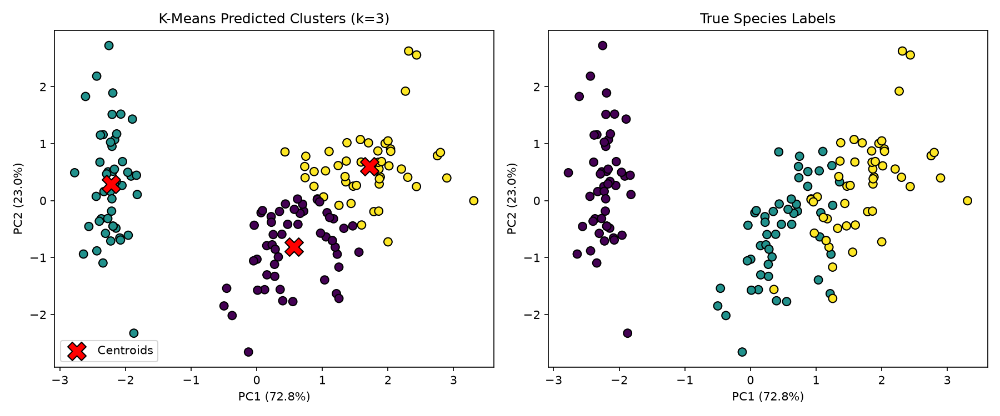
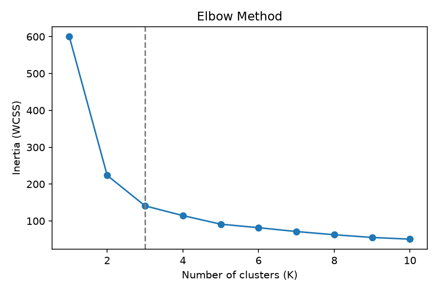
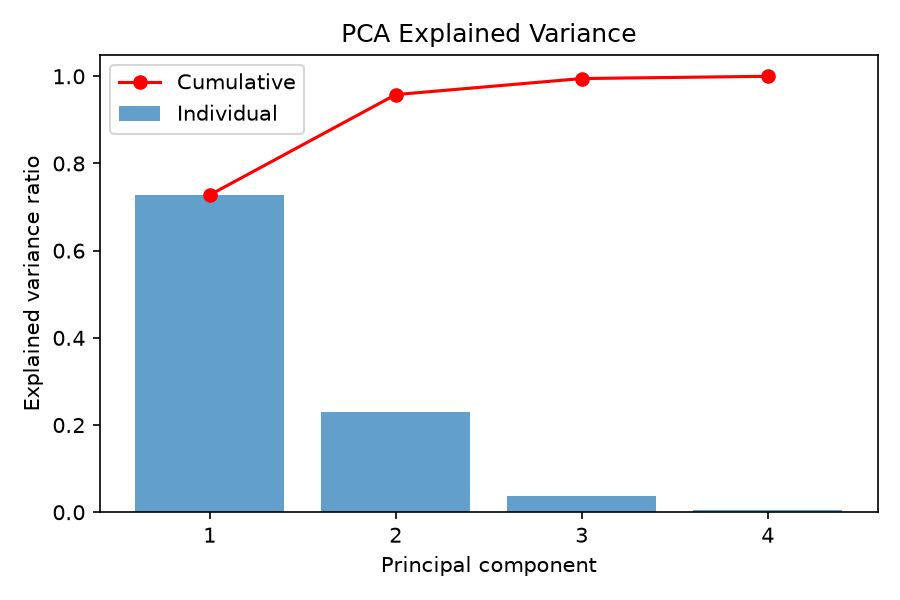
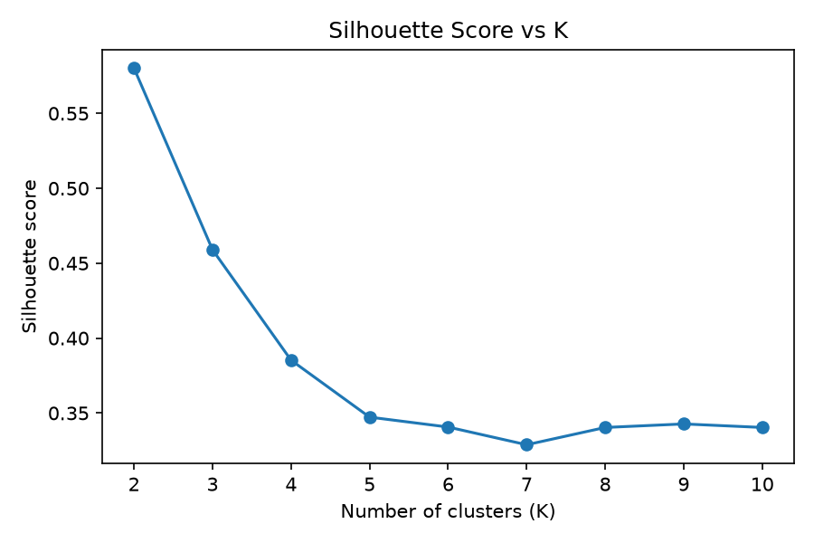
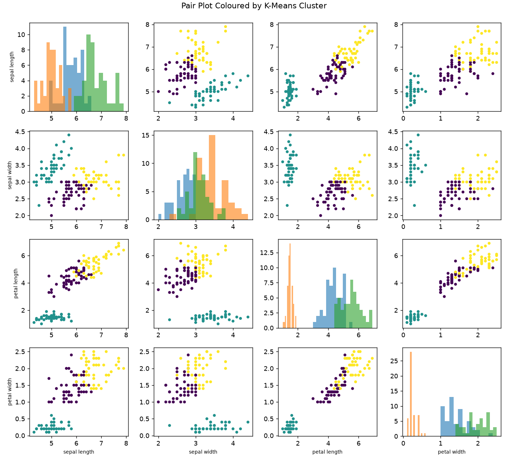
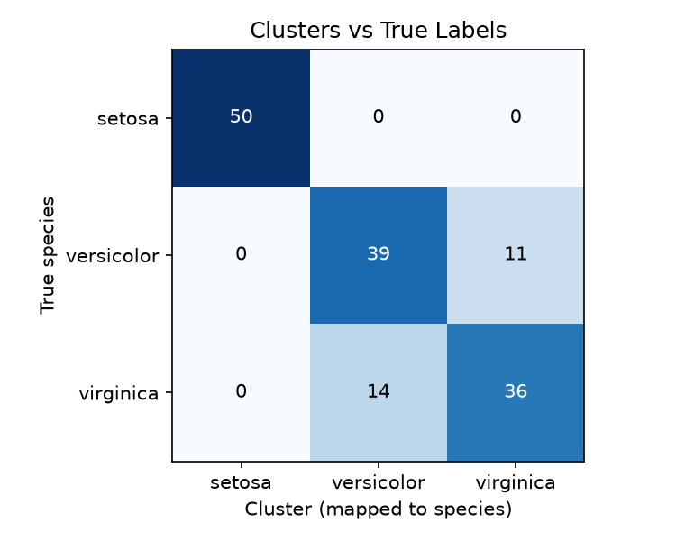
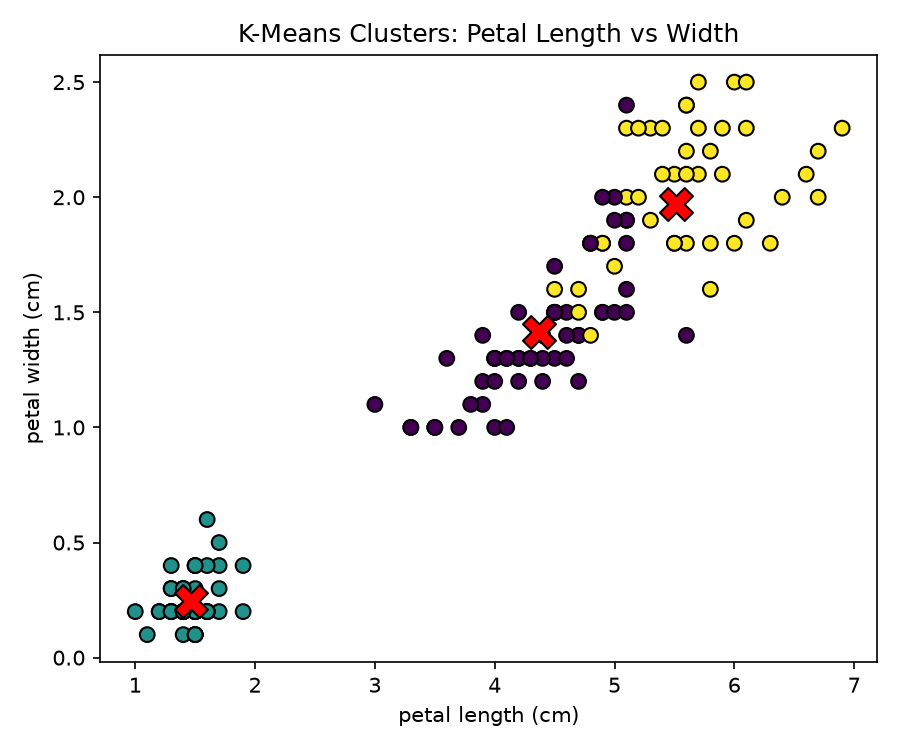
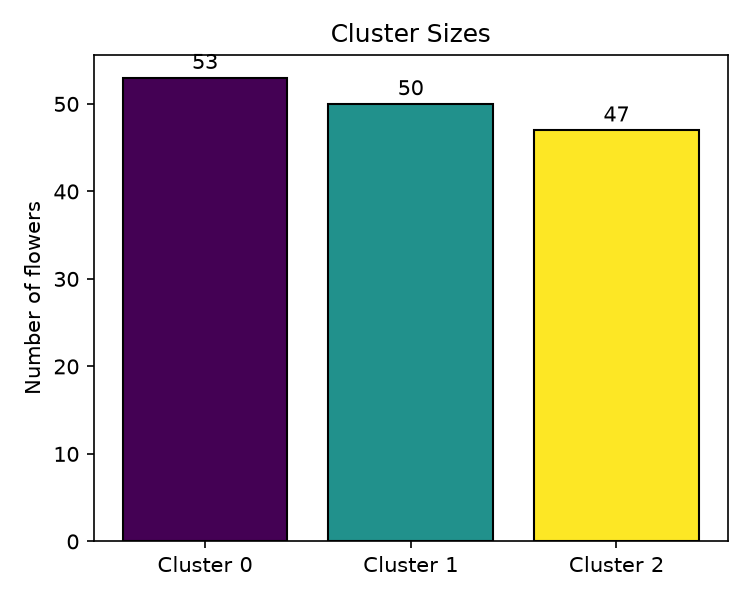

# Iris Flower Clustering Project

Unsupervised machine learning on the classic Iris dataset: group 150 flowers into clusters using only their measurements, then check how well the clusters match the real species.

Part of **Week 3 – Clustering & Dimensionality Reduction** (Machine Learning & AI course).

## Dataset

- **Source:** [Iris dataset, UCI Machine Learning Repository](https://archive.ics.uci.edu/ml/datasets/iris) (also on Kaggle)
- **Samples:** 150 (50 each of *Iris setosa*, *Iris versicolor*, *Iris virginica*)
- **Features:** sepal length, sepal width, petal length, petal width (cm)

## Objectives

1. Apply K-Means clustering (k = 3)
2. Visualize the clusters with scatter plots
3. Compare predicted clusters with the true labels
4. Reduce the data to 2D with PCA

## Methodology

1. Load `iris.data` and standardize the features (`StandardScaler`)
2. Choose K with the elbow method and silhouette scores
3. Fit K-Means (k = 3) and print the cluster centers
4. Apply PCA (2 components) and report the explained variance ratio
5. Compare clusters with true species (cross-tab, adjusted Rand index, accuracy)
6. Save and reload the trained model with joblib

## Results

| Metric | Value |
|---|---|
| PCA variance explained (PC1 / PC2) | 72.77% / 23.03% |
| Total variance kept by 2 components | 95.80% |
| Adjusted Rand Index | 0.62 |
| Cluster-to-species accuracy | 83.33% |

- Setosa is separated perfectly.
- Versicolor and virginica overlap, so 25 of those 100 flowers fall in the wrong cluster. K-Means groups by distance and never sees the labels.

### Plots

| | |
|---|---|
|  |  |
|  |  |
|  |  |
|  |  |

## How to run

```bash
git clone https://github.com/ayushshetty378-dev/Iris-Flower-Clustering.git
cd Iris-Flower-Clustering
pip install -r requirements.txt
python week3_assignment.py
```

The script reads `iris.data` from the same folder, prints the results, and saves all plots and `kmeans_iris.joblib` there.

## Project structure

```
├── week3_assignment.py   # full analysis script
├── iris.data             # dataset (UCI format, no header)
├── requirements.txt
├── *.png                 # generated plots
└── kmeans_iris.joblib    # saved K-Means model
```

## Tools

Python, pandas, NumPy, scikit-learn, matplotlib, joblib

## Conclusion

K-Means recovers the main structure of the Iris data without labels: it cleanly isolates setosa and only partly separates the two overlapping species.
